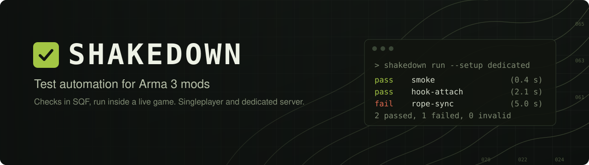

<p align="center">
    
</p>

<p align="center">
    
    
    
    
</p>

<p align="center">
    <sup><strong><a href="#quickstart">Quickstart</a> | <a href="docs/index.md">Documentation</a> | <a href="spec/contract/index.md">Check API and command line</a></strong></sup>
</p>

**Shakedown** is Playwright for Arma 3. You write checks in SQF, and Shakedown runs them inside a live game and tells you which passed.

## Features

- **Singleplayer and dedicated server.** The same check runs in both, with game clients and headless clients, all on one Windows machine.
- **Fast.** The game starts once. Every check gets a fresh session, reset in place in under a second.
- **Multiplayer-aware.** Act as a player through the mod's own actions and CBA keybinds, and assert on the server, `p1`, `p2` or every machine at once.
- **Clear verdicts.** Each check ends `pass`, `fail` or `invalid`, with a reason, its script errors and each machine's log lines.
- **Agent-ready.** `shakedown mcp` gives an AI agent such as Claude Code every command as a tool.

> [!NOTE]
> Shakedown 0.1.0 is in development and nothing is published yet. You install it by building it from this repository.

## Requirements

- 64-bit Windows 10 or 11, with Arma 3 2.22 or later on the stable branch, installed by Steam.
- The Steam client running and logged in to an account that owns Arma 3. Without it the game exits at once.
- To build: the Rust toolchain 1.99 or later, HEMTT 1.23 and Python 3, each on `PATH`.
- CBA_A3 only when your mod needs it, or when a check presses a CBA keybind with `skd_fnc_pressKey`. A check that presses no key needs no CBA. Shakedown is built against CBA_A3 3.19.0. ACE3 is optional: with ACE medical loaded, the reset gives each player ACE's full heal, checked against ACE3 3.21.2.

## Quickstart

### 1. Install

From the root of this repository:

```
python tools/install.py
```

This builds `shakedown.exe`, the `@shakedown` addon and its extension into `target\shakedown\`. Put that folder on `PATH`. Keep `shakedown.exe` and `@shakedown` together. To install somewhere else, give the folder as the first argument: `python tools/install.py C:\Tools\Shakedown`.

### 2. A project file

A project is a folder that holds a `shakedown.toml`. Put it in your mod's repository:

```toml
game = 'C:\Program Files (x86)\Steam\steamapps\common\Arma 3'
checks = "checks"

[mods.mymod]
path = 'C:\path\to\mymod\.hemttout\build'
patch = "mymod_main"

[setups.sp]
mode = "singleplayer"
mods = ["mymod"]

[setups.dedicated]
mode = "dedicated"
clients = 2
mods = ["mymod"]
```

`path` is the folder the game loads, and `patch` is a `CfgPatches` class of the mod, whose version the result file records. For a CBA-based mod, also declare `[mods.cba]` with the path of CBA's folder, and list it first in each setup's `mods`. Use single quotes so Windows paths keep their backslashes.

### 3. A first check

Save this as `checks\smoke.sqf`:

```sqf
// @check SMOKE-01 A crate placed in front of p1 reaches every client
// @tags smoke

private _crate = ["build the scene", {
    ["p1", AGLToASL [100, 100, 0], 0] call skd_fnc_place;
    ["Land_WoodenBox_F", AGLToASL [100, 105, 0], 0] call skd_fnc_create
}] call skd_fnc_step;

["every client sees the crate", {
    ["clients", { !isNull (_this select 0) }, "==", true, "the crate exists", 10, [_this select 0]] call skd_fnc_expectEach;
}, [_crate]] call skd_fnc_step;

["p1", { damage player }, "<", 0.1, "p1 is unhurt"] call skd_fnc_expectOn;
```

The header names what the check proves. The body runs on the lead machine: `p1` in singleplayer, the server on a dedicated session. Code given to another machine sees only what it is passed, as `_this`. `shakedown list` reads every check header without the game and reports any mistake in one.

### 4. Run it in singleplayer

```
shakedown run --setup sp
```

With no session running, `run --setup` starts a session of that setup, runs every check and stops the session. To keep a session up for many runs:

```
shakedown session start --setup sp
shakedown run smoke
shakedown session stop
```

### 5. Run it on a dedicated server with two clients

```
shakedown run --setup dedicated
```

This starts a dedicated server and the game clients `p1` and `p2` on the one machine, runs the check, and stops them all. The same check runs in both setups without a change.

### 6. Read the result

`run` prints one line per check, then a summary with the path of the result file:

```
pass    smoke  (0.0 s)
1 passed, 0 failed, 0 invalid, 0 not run. Result: C:\...\.shakedown\runs\r-20261105-161317-1\result.json
```

The exit code is 0 when every check passed, 1 when a check failed, and 2 when none failed and one was `invalid` or the run was stopped. Each run folder under `.shakedown\runs\` holds `result.json`, with each check's outcome, reason, steps, script errors and evidence, and each machine's log lines for the run and for each check. Add `--json` to any command for one JSON document on stdout. Git ignores everything in `.shakedown\`.

## Documentation

- **[docs/](docs/index.md)** covers every feature: the project file, sessions, writing and running checks, results, reloading and the agent tools.
- **[spec/contract/](spec/contract/index.md)** is the public interface: the check API, the command line, the agent tools and the result file.
- **[CLAUDE.md](CLAUDE.md)** is the map of this repository and how it is worked on.
