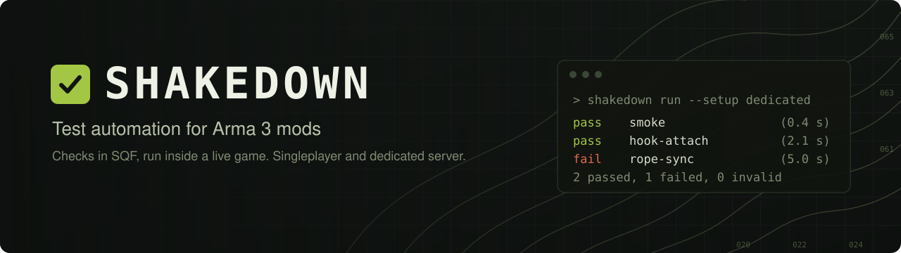

<p align="center">
    
</p>

<p align="center">
    
    
    
    
    
</p>

<p align="center">
    <sup><strong><a href="docs/quickstart.md">Quickstart</a> | <a href="docs/index.md">Documentation</a></strong></sup>
</p>

**Shakedown** is Playwright for Arma 3. You write tests of your mod in SQF, and Shakedown runs them inside a live game, in singleplayer or on a dedicated server with clients, and tells you which passed and why the others did not.

## Features

- **Tests in plain SQF**, run inside the live game: no build step, no macros, no other language ([Writing checks](docs/writing-checks.md)).
- **Singleplayer and dedicated server**, with up to 8 game clients and 8 headless clients on one machine, and clients that join late, leave and join again ([Dedicated sessions](docs/dedicated-sessions.md)).
- **One game start for many runs**, with a reset to the mission's start between tests in under a second, cleanups for state the reset cannot name, and a fresh mission for a test that needs one ([Scenes, resets and cleanups](docs/scenes-resets-and-cleanups.md)).
- **Every machine by name**: run code, wait and assert on the server, one client, every client at once, or check that they all agree ([Waits and assertions](docs/waits-and-assertions.md)).
- **Players act through the mod**: its scroll-menu actions, CBA keybinds and ACE interaction menu, without touching your mouse or keyboard ([Acting through the mod](docs/acting-through-the-mod.md)).
- **Recorded events**: catch the mod's CBA events and the engine's mission events on any machine, with their arguments and clocks ([Recording events](docs/recording-events.md)).
- **`pass`, `fail` or `invalid`, always with a reason**: a crash, a hang, a stopped clock or a struggling machine is `invalid`, never a false failure ([Outcomes](docs/outcomes-and-broken-sessions.md)).
- **Script errors on any machine** fail the test, traced to their machine, file, line and step ([Script errors and logs](docs/script-errors-and-logs.md)).
- **One JSON result file per run**, with each test's steps and their times, the evidence, the mod versions each machine loaded, and each machine's log lines ([Results](docs/results.md)).
- **Every setup with one command**, repeats with a flaky summary, slow steps flagged, and unattended runs that leave nothing running ([Every setup and repeats](docs/every-setup-and-repeats.md)).
- **Reload changed mod files** into the running game, by a mission restart where it can and a game restart where it must ([Reloading](docs/reloading.md)).
- **Ask the running game**: run SQF, wait, try an assertion and inspect any machine from the command line ([Asking a running game](docs/asking-a-running-game.md)).
- **Hand over to a person**: a test sets up a situation and leaves the game open with a list of what to look for ([Handing over](docs/handing-over.md)).
- **Pinned mod versions** and a start check that names every missing piece at once ([Starting a session](docs/starting-and-failed-starts.md)).
- **Every command as an MCP tool** for AI agents such as Claude Code ([AI agents](docs/agent-tools.md)).
- **Private by default**: local connections only, every piece of code sent to the game recorded, and the Steam account kept out of every file ([Security and privacy](docs/security-and-privacy.md)).

## Requirements

- Windows 10 or 11, 64-bit
- Arma 3 2.22 or later, from Steam
- Steam running and logged in to an account that owns Arma 3
- 2 GB free on the drive that holds your project

## Install

With winget:

```
winget install casvanluijtelaar.Shakedown
```

The package's moniker is `shakedown`, so `winget install shakedown` works too. In scripts use the full id `casvanluijtelaar.Shakedown`, which always matches exactly one package.

Or with the one-line script, in PowerShell:

```
irm https://github.com/casvanluijtelaar/shakedown/releases/latest/download/install.ps1 | iex
```

or unpack `shakedown-windows-x64.zip` from the [latest release](https://github.com/casvanluijtelaar/shakedown/releases/latest) into a folder and put that folder on `PATH`. Keep `shakedown.exe` and `@shakedown` together. No Rust, HEMTT or Python is needed. Open a new terminal and check with `shakedown version`.

[Installing, upgrading and removing](docs/install.md) has the details, and how to build from source.

## Quickstart

A project is a folder with a `shakedown.toml`. Put it in your mod's repository:

```toml
game = 'C:\Program Files (x86)\Steam\steamapps\common\Arma 3'
tests = "tests"

[mods.mymod]
path = 'C:\path\to\mymod\.hemttout\build'
patch = "mymod_main"

[setups.sp]
mode = "singleplayer"
mods = ["mymod"]

[setups.dedicated]
mode = "dedicated"
clients = 2
mods = ["mymod"]
```

Save a first test as `tests\smoke.sqf`:

```sqf
// @check SMOKE-01 A crate placed in front of p1 reaches every client
// @tags smoke

private _crate = ["build the scene", {
    ["p1", AGLToASL [100, 100, 0], 0] call skd_fnc_place;
    ["Land_WoodenBox_F", AGLToASL [100, 105, 0], 0] call skd_fnc_create
}] call skd_fnc_step;

["every client sees the crate", {
    ["clients", { !isNull (_this select 0) }, "==", true, "the crate exists", 10, [_this select 0]] call skd_fnc_expectEach;
}, [_crate]] call skd_fnc_step;

["p1", { damage player }, "<", 0.1, "p1 is unhurt"] call skd_fnc_expectOn;
```

Run it in singleplayer, then on a dedicated server with two clients:

```
> shakedown run --setup sp
session s-20261105-161317: started p1 (process 3604)
session s-20261105-161317: ready
pass    smoke  (0.0 s)
1 passed, 0 failed, 0 invalid, 0 not run. Result: C:\...\.shakedown\runs\r-20261105-161317-1\result.json
> shakedown run --setup dedicated
```

Each command starts the game in that setup, runs the test and stops the game. To keep the game running between runs, use `shakedown session start --setup sp`, then `shakedown run` as often as you like, and `shakedown session stop`. No mod yet? Leave out `[mods.mymod]` and write `mods = []`.

The [quickstart](docs/quickstart.md) walks through each step and how to read the result.

### Exit codes

| Code | Means |
|---|---|
| `0` | Every test that ran passed. |
| `1` | A test failed. |
| `2` | No test failed, but one was `invalid`, could not run because its session failed to start or broke, or the run was stopped. |
| `3` | The request is wrong: an unknown command, option, test, machine or setup, a malformed project file, SQF that does not compile. |
| `4` | The request cannot be done now: no session, a session already running, Steam, the game, a mod or a port missing, a start or reload that failed, a broken or busy session, or a runner that does not answer. |
| `5` | Shakedown itself failed; the message names its log. |

## AI agents

`shakedown mcp` is an MCP server that gives an AI agent such as Claude Code every command as a tool, returning the same JSON as the command line. Add a `.mcp.json` next to your `shakedown.toml`:

```json
{
  "mcpServers": {
    "shakedown": { "command": "shakedown", "args": ["mcp"], "timeout": 70000 }
  }
}
```

Start Claude Code in that folder, and the agent can:

- start and stop sessions, and run tests in one setup or every setup
- read results, script errors and each machine's logs
- run SQF on any machine and inspect it live
- reload changed mod files and rerun a test
- call `guide` for a short manual on writing and running tests

See [AI agents and the MCP tools](docs/agent-tools.md).

## Documentation

The [documentation](docs/index.md) has a quickstart and a page for every feature, with examples, plus a [command-line reference](docs/command-line.md), a guide to [porting an existing suite](docs/porting-a-suite.md) and [troubleshooting](docs/troubleshooting.md).

## License

Shakedown is free software under the [GNU General Public License, version 2 or later](LICENSE). A release carries `LICENSE` and `THIRD-PARTY-LICENSES.txt`, the licences of the packages compiled into it; `shakedown.exe` includes `rmcp`, Apache-2.0 only, and so is distributed under GPL version 3.

The license covers Shakedown's code, not the game. Using Shakedown means running Arma 3, and what you may do with Arma 3 is set by Bohemia Interactive's EULA and its rules for tools and mods. Shakedown is meant for testing non-commercial mods.
